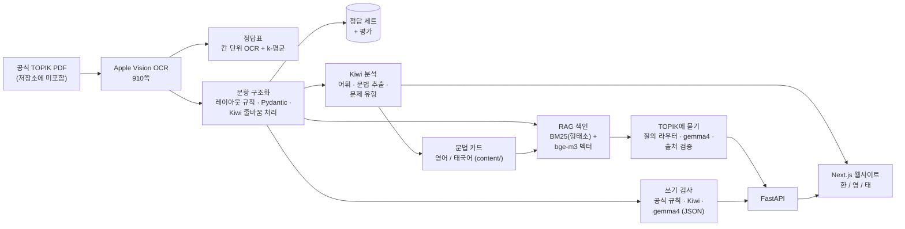

# TOPIK 지름길 (TOPIK Shortcut)

[English](README.md) · **한국어**

한국어능력시험 **TOPIK II**를 위한 AI 학습 도구입니다. **실제 기출문제**를 바탕으로 OCR 파이프라인, 한국어 자연어 처리 분석, RAG 질의응답, 공식 채점 기준에 근거한 쓰기 검사기를 만들었습니다. 모든 구성 요소를 평가했고, 수치와 함께 한계도 그대로 적었습니다.

> 포트폴리오 프로젝트(진행 중) · 범위와 설계 결정: [SPEC.md](SPEC.md) · 배운 점: [LEARNING_LOG.md](LEARNING_LOG.md)

## 데모

https://github.com/user-attachments/assets/63f116fa-6e24-4378-ab4d-930fbc7bce1e

*2분 42초, 태국어 화면, 소리 없음: 홈 → 어휘(품사 필터, 검색) → 문법 카드 → 쓰기 검사 → TOPIK에 묻기(로컬 모델이라 답변에 15~60초 걸림).*

## 주요 기능

| 기능 | 설명 |
|---|---|
| **기출 분석** | 공식 기출 3회분(제102·96·91회) → 문제 유형 지도, 어휘 2,506개, 실제 기출 예문이 포함된 문법 98개 |
| **TOPIK에 묻기** (RAG) | 한국어·영어·태국어로 질문하면 기출문제와 문법 카드만 근거로 답하고, 모든 내용에 출처를 표시 |
| **쓰기 검사** | 51~54번: 공식 규칙(분량, '-다' 종결 어미, 제목, 문제 베끼기 등), 띄어쓰기·구어 표현 검사, 내용 검사(무의미한 글, 주제 이탈, 자료 항목 누락), AI 맞춤법 검사, 원고지 답안지 |
| **웹사이트** | Next.js, 한국어/영어/태국어 화면, 휴대폰 지원 |

모든 기능이 **노트북 한 대**(8GB 맥북)에서 동작합니다. 유료 API를 쓰지 않고, 데이터가 외부로 나가지 않습니다.

## 핵심 결과

| 구성 요소 | 지표 | 결과 |
|---|---|---|
| OCR → 문항 구조화 | 직접 검수한 정답 세트(131개 필드)의 필드 정확도 | 89.3% → 수정 후 **95.4%** ¹ |
| 정답표 추출 | 제102회 듣기 정답(직접 확인) | **50 / 50** |
| TOPIK에 묻기 — 검색 | 자동 생성 질문 1,070개(한·영·태)의 hit@5 | **99.8%** ² |
| TOPIK에 묻기 — 답변 | 잘못된 출처 표기 | **0 / 21** |
| 쓰기 검사 — 규칙 + 내용 | 삽입한 오류 탐지 / 공식 모범 답안 오탐 | **111 / 112**, **0** ¹ |
| 쓰기 검사 — AI | 오타 탐지 / 정상 글에서 만들어 낸 오류 | **5 / 6**, **0** |

¹ 개발 세트: 같은 데이터로 규칙을 조정함. ² 낙관적 수치: 템플릿 질문에 문법 이름이 그대로 들어 있음. 자세한 내용은 아래에 있습니다.

## 아키텍처



## 설계 결정과 배운 점

- **정답표:** OCR이 원 숫자(①②③④)를 읽을 때 정밀도는 100%였지만 재현율은 60%뿐이었습니다. → 확실하게 읽은 칸을 라벨로 삼고 **기호 모양을 k-평균으로 군집화**해 나머지를 채워 50/50을 맞혔습니다.
- **한국어 줄바꿈:** 시험지 본문은 단어 *중간*에서 줄이 바뀝니다(이루어 / 진다). Kiwi 기반 규칙으로 붙여 쓸지 띄어 쓸지 판단해 시험 사례 41/41을 맞혔고, Kiwi의 띄어쓰기 모델이 붙이라고 한 "산성이 | 중화"도 띄어 써야 함을 찾아냈습니다.
- **하이브리드 검색이 항상 낫지는 않음:** 같은 가중치의 BM25 + 벡터 검색은 문법 질문에서 벡터 검색만 쓸 때보다 낮았습니다(공통 형태소가 잡음이 됨). 반면 기출 문장을 붙여 넣는 검색에서는 BM25가 가장 좋았습니다. → **질의 라우터**가 질문마다 맞는 검색을 고릅니다.
- **충실성 검증:** 답변의 모든 출처는 실제로 검색된 문서 ID여야 합니다. 이 검증으로 모델이 본문에 보이던 ID를 그대로 베끼는 문제를 찾았고, 그 ID를 숨겨진 메타데이터로 옮겼습니다. 쓰기 검사도 같은 원리로, AI가 지적한 오류는 실제 답안에 있는 문장을 인용해야 합니다.
- **공식 자료에 근거한 규칙:** 채점 규칙은 TOPIK 공식 안내 자료에서 가져왔고, 분량 계산기는 공식 표기 "(288자)", "(300자)"를 정확히 재현합니다.
- **라벨링 없이 평가하기:** 우리 데이터에서 자동으로 만든 질문(RAG)과 공식 모범 답안에 **오류를 일부러 넣는 방식**(쓰기 검사)으로 평가했고, 정상 글에서의 오탐도 항상 함께 측정했습니다.
- **작은 로컬 모델은 찾기는 잘하지만 고치기는 약함**(6개 중 5개 탐지, 수정 5개 중 3개만 정확) → "가능한 오류"로만 보여 주고, TOPIK 규칙에 어긋나는 AI 수정안은 제외합니다.

## 상세 결과

### 추출 (OCR → 문항 구조화)

직접 검수한 정답 세트: 제102회, 131개 필드 (`eval/eval_extraction.py`)

| 필드 | 개수 | 완전 일치 (수정 전 → 후) | 수정 후 CER |
|---|---|---|---|
| 선택지 | 50 | 100% → 100% | 0.00% |
| 지시문 | 19 | 94.7% → 100% | 0.00% |
| 문제 본문 | 54 | 81.5% → 90.7% | 1.21% |
| 공통 지문 | 8 | 62.5% → 87.5% | 0.07% |
| **전체** | **131** | **89.3% → 95.4%** | **0.62%** |

남은 오류는 실제 OCR 오인식(`2`와 `²`, `<`와 `《`)과 그래프입니다. 수정 사항을 같은 정답 세트에서 찾았으므로 "수정 후" 수치는 개발 세트 점수입니다.

### TOPIK에 묻기 (RAG)

우리 데이터로 자동 생성한 질문 1,070개(한국어·영어·태국어), hit@5 · MRR (`eval/eval_rag.py`):

| 검색 방식 | 의미 | 기출 용례* | 차이 | 바꿔 말하기 | 문장 붙여 넣기 | **전체** |
|---|---|---|---|---|---|---|
| 키워드 (Kiwi 형태소 BM25) | 89.1% | 78.6% | 78.8% | 49.5% | **100%** | 78.6% · 0.76 |
| 의미 (bge-m3 벡터) | 99.3% | 95.2% | 100% | 100% | 98.3% | 98.3% · 0.97 |
| 하이브리드 (RRF, 같은 가중치) | 98.0% | 86.7% | 91.5% | 100% | 100% | 94.5% · 0.92 |
| **라우터 + 문법 이름 일치** | **100%** | **100%** | **100%** | **100%** | 98.3% | **99.8% · 0.99** |

\* 상위 5개 + 검색된 문법 카드에 연결된 기출문제.
**답변** (실제 답변 12개, gemma4:e2b): 출처 21개 중 잘못된 것 0개 · 12개 중 11개가 질문과 같은 언어 · "찾을 수 없음"이라고 정직하게 답한 경우 1개 · 중앙값 16초.
**주의:** 템플릿 질문에는 문법 이름이 그대로 들어 있어 실제 사용자 질문에서는 점수가 더 낮을 것입니다.

### 쓰기 검사 (51~54번)

제102·96·91회 공식 모범 답안에 오류를 넣어 평가 (`eval/eval_writing.py`):

| 단계 | 결과 |
|---|---|
| 분량 계산 | 공식 글자 수와 일치 (300 ✓, 288 ✓, 279 vs 280) |
| 규칙 + 언어 + 내용 (오류 21종) | **111 / 112** 탐지, 정상 답안 12개에서 오탐 **0** |
| AI (gemma4:e2b, JSON 출력) | 오타 **6개 중 5개** 탐지, 만들어 낸 오류 **0**; 수정안 **5개 중 3개** 정확 |

첫 버전은 *정상* 답안에 오류를 *하나씩* 넣어서만 평가했기 때문에 무의미한 글은 시험하지 않았습니다. 직접 아무 글자나 입력해 보니 "문제 없음"이 나왔습니다. 그래서 내용 단계(ㅁㄴㅇㄹ 같은 자모, 한국어가 아닌 글, 반복 문장, 모든 문장의 '-다' 종결, 문제의 핵심 항목)와 새 오류 9종(주제 이탈 시험으로 **다른 회차의 답안** 포함)을 추가했습니다. 놓친 1건은 시험 방식의 문제입니다(해결 방안 문장을 지우면서 주제 문장도 지워져 주제 이탈로 판정). 내용 검사는 얕은 검사로, 무의미하거나 주제에서 벗어난 글은 잡지만 논리의 질은 평가하지 않습니다.

## 기술 스택

**Python:** Apple Vision OCR(`ocrmac`), PyMuPDF, Pydantic, Kiwi(`kiwipiepy`), NumPy, FastAPI · **AI (로컬, Ollama):** `bge-m3` 임베딩, `gemma4:e2b-it-qat` · **웹:** Next.js 16(App Router, Cache Components), TypeScript, Tailwind CSS · 작성한 명세서를 바탕으로 **Claude Code**와 함께 개발

## 폴더 구조

```
pipeline/   OCR, 정답표, 문항 구조화, Kiwi 분석, 내보내기, 검수 페이지
rag/        청크, 하이브리드 검색 + 라우터, 출처 검증이 있는 답변
writing/    공식 규칙, 띄어쓰기, AI 단계, 모범 답안
eval/       추출 · RAG · 쓰기 검사 평가
api/        웹사이트용 FastAPI
web/        Next.js 웹사이트 (한 / 영 / 태)
content/    직접 만든 문법·문제 유형 설명 (영어 / 태국어)
data/       기출 PDF, OCR, 가공 데이터 — git에 포함하지 않음 (저작권)
```

## 로컬에서 실행하기

Python 3(`.venv`), Node.js, 그리고 `bge-m3`와 `gemma4:e2b-it-qat`를 설치한 [Ollama](https://ollama.com)가 필요합니다.
기출 데이터는 저장소에 없으므로 PDF를 내려받아 파이프라인(`pipeline/`)을 먼저 실행해야 합니다.

```bash
.venv/bin/python -m pipeline.export_web                              # 웹사이트용 데이터 -> data/web/
.venv/bin/uvicorn api.main:app --host 127.0.0.1 --port 8000          # TOPIK에 묻기 + 쓰기 검사 API
cd web && npm run dev                                                # 웹사이트: http://127.0.0.1:3000/ko
```

또는 명령 하나로 둘 다 실행할 수 있습니다(이 맥에서만 접속 가능, Next.js 텔레메트리 끔, Ctrl+C로 둘 다 종료): `./scripts/start.sh`

**휴대폰 모드** (와이파이로 휴대폰에서 테스트): 일반 서버를 끈 뒤 `./scripts/phone_mode.sh`를 실행합니다. 임의의 비밀 키가 들어간 링크가 출력되며, 키가 없으면 웹사이트와 API 모두 401로 응답합니다(공용 와이파이에서도 안전). Ctrl+C로 모두 종료됩니다.

## 한계와 다음 단계

- 공개된 12회분 중 3회분만 처리했습니다. 이전 회차는 정답표 형식을 추가로 처리해야 합니다.
- ¹ 표시 수치는 개발 세트 점수입니다. 다음 단계로 제96회를 별도 시험 세트로 검수할 예정입니다.
- 문법·문제 유형 설명, 어휘 2,506개 번역, 쓰기 주제 항목은 Claude가 작성했고 **아직 교사 검수를 받지 않았습니다.**
- 듣기(음성 + 대본)와 53번 그래프 설명은 아직 포함하지 않았습니다.
- 로컬 모델은 느리고(15~60초) 수정 능력이 약합니다. Claude API로 바꿀 수 있도록 설계했습니다.
- 쓰기 검사는 아직 내용의 질을 채점하지 않습니다(다음 단계: 더 강한 모델로 공식 채점 기준에 따라 채점).

## 데이터와 저작권

기출 PDF는 TOPIK 공식 누리집(topik.go.kr)에서 내려받았으며 이 저장소에는 **포함하지 않습니다.** 저작권은 국립국제교육원(NIIED)과 지문의 원저작자에게 있습니다. 공식 PDF에서 저작권 때문에 공개하지 않은 지문은 파이프라인이 찾아 제외합니다. 상업적으로 이용하려면 국립국제교육원의 허락이 필요합니다.
