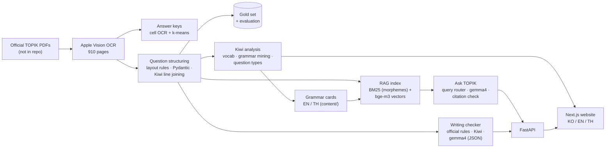

# TOPIK Shortcut

**English** · [한국어](README.ko.md)

An AI study tool for the Korean proficiency test **TOPIK II**, built from **real past exams**: an OCR pipeline, Korean NLP analysis, a RAG question-answering assistant, and a writing checker grounded in the official scoring rules. Every component is evaluated, and the README reports the numbers including their limits.

> Portfolio project, work in progress. Scope and decisions: [SPEC.md](SPEC.md) · what I learned: [LEARNING_LOG.md](LEARNING_LOG.md)

## Demo

https://github.com/user-attachments/assets/63f116fa-6e24-4378-ab4d-930fbc7bce1e

*2:42, Thai interface, no sound: home → vocabulary (part-of-speech filter, search) → grammar card → writing checker → Ask TOPIK (the local model takes 15–60 s per answer).*

## What it does

| Feature | Description |
|---|---|
| **Exam analysis** | 3 official exams (rounds 102, 96, 91) → question-type map, 2,506 words, 98 grammar points with real exam sentences |
| **Ask TOPIK** (RAG) | Ask in Korean, English or Thai; answers come only from past exams and grammar cards, with a citation for every fact |
| **Writing checker** | Q51–54: official rules (length, written -다 endings, title, copying…), spacing and spoken-style checks, content checks (nonsense, off-topic, missing chart items), AI spelling check; 원고지 answer grid |
| **Website** | Next.js, Korean / English / Thai interface, phone-friendly |

Everything runs **on a laptop** (8 GB MacBook): no paid API, no data leaves the machine.

## Key results

| Component | Metric | Result |
|---|---|---|
| OCR → structured questions | exact field accuracy on a hand-checked gold set (131 fields) | 89.3% → **95.4%** after fixes ¹ |
| Answer-key extraction | correct answers, round 102 listening (checked by hand) | **50 / 50** |
| Ask TOPIK — retrieval | hit@5 on 1,070 generated queries (KO/EN/TH) | **99.8%** ² |
| Ask TOPIK — answers | invalid citations | **0 / 21** |
| Writing checker — rules + content | injected errors caught / false alarms on official answers | **111 / 112**, **0** ¹ |
| Writing checker — AI | typos found / errors invented on clean essays | **5 / 6**, **0** |

¹ development set: rules were tuned on the same data. ² optimistic: template queries contain exact grammar names. Details below.

## Architecture



## Engineering decisions and lessons

- **Answer keys:** OCR read circled answers (①②③④) with 100% precision but only 60% recall → used its confident reads as labels and **clustered symbol shapes (k-means)** to fill the gaps: 50/50.
- **Korean line breaks:** exam text wraps lines *inside* words (이루어 / 진다). A Kiwi-based rule decides space vs. no space: 41/41 on test cases; it also found that "산성이 | 중화" must not be joined even though Kiwi's own spacing model said so.
- **Hybrid search was not automatically better:** equal-weight BM25 + vectors lost to vectors alone on grammar questions (shared morphemes add noise), but BM25 won for pasted exam sentences → a **query router** picks the search per query.
- **Faithfulness checks:** every citation must be a retrieved id; the check caught the model copying ids from text it had seen → those ids became hidden metadata. Same idea in the writing checker: an AI "error" must quote text that is really in the answer.
- **Rules from official sources:** the scoring rules come from the official TOPIK guides, and the length counter reproduces the official counts "(288자)" and "(300자)" exactly.
- **Evaluate without labelling:** test sets generated from our own data (RAG) and **error injection** into official model answers (writing checker), always with false alarms measured on clean text.
- **Small local model = finds well, fixes poorly** (5/6 found, 3/5 fixes right) → shown as "possible error", and AI fixes that break TOPIK rules are dropped.

## Detailed results

### Extraction (OCR → structured questions)

Hand-checked gold set: round 102, 131 fields (`eval/eval_extraction.py`).

| Field | n | Exact (before → after fixes) | CER after |
|---|---|---|---|
| Choices | 50 | 100% → 100% | 0.00% |
| Instruction | 19 | 94.7% → 100% | 0.00% |
| Question text | 54 | 81.5% → 90.7% | 1.21% |
| Shared passage | 8 | 62.5% → 87.5% | 0.07% |
| **All** | **131** | **89.3% → 95.4%** | **0.62%** |

Remaining errors are real OCR misreads (`2` vs `²`, `<` vs `《`) and charts. The fixes were found on this gold set, so "after" is a development score.

### Ask TOPIK (RAG)

1,070 test queries generated from our own data (Korean / English / Thai), hit@5 · MRR (`eval/eval_rag.py`):

| Search | meaning | usage in exams* | difference | paraphrase | pasted sentence | **all** |
|---|---|---|---|---|---|---|
| keyword (BM25 on Kiwi morphemes) | 89.1% | 78.6% | 78.8% | 49.5% | **100%** | 78.6% · 0.76 |
| meaning (bge-m3 vectors) | 99.3% | 95.2% | 100% | 100% | 98.3% | 98.3% · 0.97 |
| hybrid (RRF, equal weight) | 98.0% | 86.7% | 91.5% | 100% | 100% | 94.5% · 0.92 |
| **router + grammar-name match** | **100%** | **100%** | **100%** | **100%** | 98.3% | **99.8% · 0.99** |

\* top 5 + exam questions linked from the retrieved grammar card.
**Answers** (12 real answers, gemma4:e2b): 21 citations, 0 invalid · 11/12 in the question's language · 1 honest "not found" · median 16 s.
**Caveat:** template queries contain exact grammar names, so real questions will score lower.

### Writing checker (Q51–54)

Error injection into the official model answers of rounds 102, 96, 91 (`eval/eval_writing.py`):

| Layer | Result |
|---|---|
| Length counter | matches the official counts (300 ✓, 288 ✓, 279 vs 280) |
| Rules + language + content (21 error types) | **111 / 112** caught, **0** false alarms on 12 clean answers |
| AI (gemma4:e2b, JSON output) | typos **5 / 6** found, **0** invented; corrections right **3 / 5** |

The first version only injected *one* error into *correct* answers, so it never tested nonsense: a manual test with a keyboard-mash answer got "no issues". The content layer (loose ㅁㄴㅇㄹ, non-Korean text, repeated sentences, every sentence ending in the written -다 style, key items of the question) and 9 new error types (incl. **another round's answer** as an off-topic test) came from that. The one miss is a test artefact (removing the "solution" sentences also removed the topic sentences → reported as off-topic). The content checks are shallow: they catch nonsense and off-topic answers, not weak arguments.

## Tech stack

**Python:** Apple Vision OCR (`ocrmac`), PyMuPDF, Pydantic, Kiwi (`kiwipiepy`), NumPy, FastAPI · **AI (local, Ollama):** `bge-m3` embeddings, `gemma4:e2b-it-qat` · **Web:** Next.js 16 (App Router, cache components), TypeScript, Tailwind CSS · **Built with** Claude Code, from a written spec.

## Project structure

```
pipeline/   OCR, answer keys, question structuring, Kiwi analysis, exports, review pages
rag/        chunks, hybrid search + router, answers with citation check
writing/    official rules, spacing, AI layer, model answers
eval/       extraction, RAG and writing-checker evaluations
api/        FastAPI for the website
web/        Next.js website (KO / EN / TH)
content/    our own grammar and question-type content (EN / TH)
data/       exam PDFs, OCR, processed data — NOT in git (copyright)
```

## Run it locally

Needs Python 3 (`.venv`), Node.js, and [Ollama](https://ollama.com) with `bge-m3` and `gemma4:e2b-it-qat`.
Exam data is not in the repo: download the PDFs and run the pipeline first (`pipeline/`).

```bash
.venv/bin/python -m pipeline.export_web                              # data for the website -> data/web/
.venv/bin/uvicorn api.main:app --host 127.0.0.1 --port 8000          # Ask TOPIK + Writing checker API
cd web && npm run dev                                                # website: http://127.0.0.1:3000/ko
```

Or start both with one command (this Mac only, Next.js telemetry off, Ctrl+C stops both): `./scripts/start.sh`

**Phone mode** (test on a phone over Wi-Fi): stop the normal servers, then run `./scripts/phone_mode.sh`. It prints a link with a random secret key; without that key, both the website and the API answer 401 (safe on shared Wi-Fi). Ctrl+C stops everything.

## Limitations and next steps

- 3 of 12 public rounds processed; older rounds need the answer-key layouts fixed.
- Accuracy numbers marked ¹ are development scores; a held-out round (96) is the next test set.
- Grammar and question-type explanations, the 2,506 vocabulary translations and the writing topic items are written by Claude and **not yet reviewed** by a teacher.
- Listening (audio + transcripts) and chart descriptions for Q53 are not included yet.
- The local model is slow (15–60 s) and weak at corrections; the design allows switching to the Claude API.
- The writing checker does not grade content quality yet (next: a stronger model, scored against the official criteria).

## Data and copyright

Exam PDFs are downloaded from the official TOPIK site (topik.go.kr) and are **not** included in this repository. Copyright belongs to 국립국제교육원 (NIIED) and the original authors of the passages. Some reading passages are withheld in the official PDFs for copyright reasons; the pipeline detects and skips them. Commercial use would require NIIED's permission.
